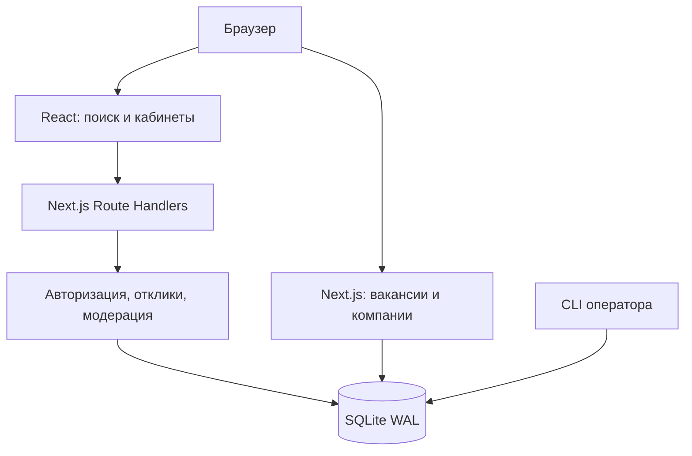

# Архитектура базовой версии

## Решение

Next.js App Router обслуживает React UI, серверные публичные страницы и Route Handlers в одном Node.js-приложении. Существующие SQLite и восстановленные ORM-модули сохранены для минимального времени разработки и совместимости с архивом. Новая логика вынесена в отдельные небольшие файлы; полный рефакторинг исходного большого platform.jsx не выполнялся.

## Данные и границы

- accounts/sessions: пользователи и хеши токенов сессий.
- companies: один профиль компании на владельца. Связь с вакансиями через owner_id.
- jobs: карточка вакансии, срок, статус active/closed и независимый статус модерации pending/approved/blocked.
- profiles: приватная анкета кандидата.
- applications: уникальная пара вакансия/кандидат и неизменяемая копия анкеты.
- favorites/saved_searches: личные списки.
- reports/moderation_events: жалобы и журнал решений.

Публичный поиск: active + approved + expires_at в будущем. Истечение применяется при чтении, поэтому для скрытия просроченных вакансий cron не нужен. При одобрении pending-вакансии срок становится 30 дней от момента проверки. Закрытые approved-вакансии остаются по прямому URL с сообщением и без кнопки отклика.

Отклик: BEGIN IMMEDIATE → проверка вакансии → проверка повторного запроса → снимок анкеты → INSERT → COMMIT. Сетевых операций внутри транзакции нет. Сбой запроса после commit безопасно повторяется: возвращается исходный ID.

Права проверяются на сервере. Кандидат получает собственные отклики, работодатель — только отклики на принадлежащие ему вакансии. Роль администратора назначается CLI. Изменения через API требуют совпадения Origin. Cookie HttpOnly, SameSite=Lax; Secure включается для HTTPS-origin. Необходимо задать канонический PRATSIA_ORIGIN перед публичным запуском.

## Приоритеты следующего этапа

1. Автоматическое подтверждение email, удаление аккаунта/данных и политика хранения.
2. Приватные PDF, ограничение размера, проверка файлов, выдача после авторизации.
3. Транзакционный outbox и email-provider; повторы и наблюдение за ошибками отправки.
4. Вынести восстановленный UI в читаемые компоненты, постепенно добавить TypeScript.
5. Замерить SQL-поиск на 10000 вакансий и 20 RPS; критерий p95 <500 мс — цель, не измеренный результат.
6. При необходимости масштабирования: PostgreSQL, нормализованные компании/members, полнотекстовый поиск, общий rate limiter, затем кэш.

## Минимальные эксплуатационные требования

Постоянный диск, резервное копирование и проверка восстановления, HTTPS, ограничение размера запросов и частоты обращений, сбор ошибок. Выбор провайдера, серверов, контейнеров и процесс деплоя намеренно оставлены для отдельного обсуждения.
